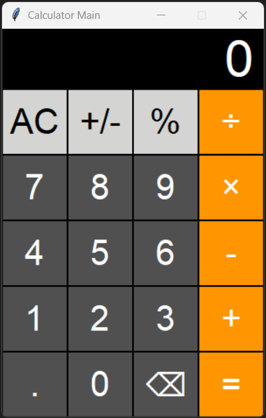

# Welcome to the Calculator Project.

This project contains a calculator program that calculates your input and provides an answer. This program for the calculator is finished and it has a sleek GUI interface to go with it. The calculator supports addition, subtraction, division, and multiplication. It has error handling for syntax errors and math errors. As time progresses, the program will be continuously maintained and improved, and new features will be added soon.

You may notice a folder called `TEST`. It contains files for calculations for each operation. It is mainly for testing purposes only and for experimental purposes only as well. It is aimed at testing out arithmetic functions and mathematical operations in Python. It was originally used as a calculator for standalone operations. But with practicality issues and being severely limited to just basic calculations, the main calculator program aims to unify all operations together alongside understanding complex questions and calculations.

The legacy folder contains the legacy version of the `main_calculator.py` program, which is terminal-based. It is the first version of `main_calculator.py`. It is located in the `LEGACY` folder under the name `calculator_main_legacy.py`. It is mainly for basic use today, as it doesn't have a GUI. For an updated program, it is much better to use the latest version of `main_calculator.py`, which is located in this folder.

The full-fledged calculator program is now available! Available with a GUI, repeatable calculations, and multiple new features, it is the main program in this project. You can find it in the `calculator_main.py` file available in this folder. Thank you for the support and my sustained learning; I'm able to create a full program in Python. This will serve as my first program and will be continuously updated as time goes by.

## Improvements Regarding Main_Calculator

In the 23rd of November 2026, a new refresh of `calculator_main.py` was introduced. `main_calculator.py` aims to solve bugs, issues, and quirks that are present in the `calculator_main.py` program. This includes preventing floating-point inaccuracies such as `0.1` + `0.2`, which produces `0.30000000000000004`, improving the `remove_zero_decimal()` function, and ensuring decimal results are displayed cleanly without unnecessary trailing zeros.

The update also implemented missing core features not present in the old version. This includes repeating the equals functionality, similar to the iOS calculator app. The new version also allows to display long numbers and results without going off screen. The arithmetic behavior has also been improved alongside development. This includes allowing users to continue calculating from previous calculations, handling division by zero safely, handling negative numbers and decimal values correctly, and still supporting core mathematical operations like addition, subtraction, multiplication, division, and percentages.

This new version also aims to improve error handling, code quality, and preserve core features and functions during development. With the improvements of the calculator app, the legacy `calculator_main.py` will be moved to the `LEGACY` folder. While you can still use it, the main program will be `main_calculator.py`. The bugs, issues, and quirks will still remain in the legacy version, but will still be maintained and preserved regardless of the improvements the new program provides.

*A revised calculator program will be implemented soon.*

## Installation

To run the calculator, you must meet the requirements listed below.

You must have Python 3.10 or newer to run this program and a terminal or command prompt in order to type inputs. If you want to modify the code for the program, feel free to do so. You need a code editor like Visual Studio Code to edit the code.

**First, install the program.**

To install the calculator program, you can clone this repository using Git:

`git clone https://github.com/fritxfloriann/main_calculator.git`

You can also download the repository as a ZIP archive and extract the contents of the program.

**Second, open the project directory.**

Enter the following command:

`cd main_calculator`

**More importantly, check your Python version.**

You can check your Python version with the following command:

`python --version`

*If you are on systems that use Python 3, type the following command:*

`python3 --version`

*Remember, `main_calculator.py` requires Python 3.10 or newer to run.*

Lastly, locate the file.

The file name for the calculator program is called `main_calculator.py`. Remember where you downloaded it. It should be in your `Recent` or `Downloads` directory if you are on Windows. Check your file explorer if you are on Linux or macOS.

If you don't know how to use the program, the instructions below show you how to use the calculator. Remember, this is not a scientific calculator. It will only handle basic computing and calculations.

## Instructions

To use the calculator, you are greeted with a prompt that requires your input to function. 

*The instruction uses the `main_calculator.py` file.*

First, open the executable file called `main_calculator.py`. You are greeted with the GUI of the program.

Enter the first number you want to calculate by tapping a number.

For example, enter the first number you want to calculate. Then select an operation you want to calculate your numbers with.

Secondly, once you're done, press the button with the equal symbol. This will now calculate the total of the calculations you have entered.

After that, you will get the answer to your calculations. This is now your total. Congratulations, you have calculated your answer.

*Remember, dividing by zero can result in a Math Error.*

## Features of the Calculator

The features included in the program are packed with tons of functionality, operations, and basic capabilities that you can use with the program. It is important to note that this program is only equivalent to a basic calculator. A scientific calculator will come soon.

*This section refers to the `main_calculator.py` program.*

### Arithmetic Operations

There are a couple of arithmetic operations available on the calculator program. It is used for calculations. That includes:

• *Addition* **(+)**

• *Subtraction* **(-)**

• *Multiplication* **(×)**

• *Division* **(÷)**

• *Percentage* **(%)**

• *Equals* **(=)**

### Number Manipulation

These functions help you not just interact with and calculate numbers, but manipulate them to achieve a precise calculation.

A couple of notable functions include:

• *Number Input* **(0-9)**

• *Decimal Input Input* **(.)**

• *Sign Conversion* **(+/-)**

• *Percentage* **(%)**

• *Backspace* **(⌫)**

• *Clear All* **(AC)**

### Error Handling

When the program runs into a problem that it cannot solve, there is error handling present in order to keep the problem functioning.

Here are the error handling features that are available with `main_calculator.py`:

• *Division By Zero Protection* **(Catches a Math Error when dividing or percenting by Zero.)**

• *Math Error* **(Displays a Math Error when the calculation is illegal.)**

• *Backspace* **(You can delete an entry one by one with the backspace function.)**

• *Error Recovery* **(Upon Math Error, pressing Backspace or AC will restart to the default state of the calculator.)**

### Keyboard Support

This program supports keyboard input using your keyboard's numpad and keys. Using the numpad, number row, and mathematical symbols on your keyboard, you can start using the program using just a keyboard.

You can use the keys tied to the arithmetic symbols and the numpad and number row keys to enter numbers from 0-9 in the program!

### GUI Interface

Improved from the original `calculator_main_legacy.py` and `main_calculator_legacy.py`, the `main_calculator.py` program is GUI-based, which is more appealing and more easier to use than being terminal-based. This enhances the user experience by providing a visual and interactive experience rather than typing numbers and choosing manually in terminals or command prompts.

  The GUI interface for the calculator looks like this:

  

 calculator_main.py 

  

  Remember, the interface may change over time as new features get continuously added.

## Main Calculator's Future Updates

Future updates for `main_calculator.py` will include a calculation history, a square root button, a resizable window, and more capabilities coming soon. A scientific calculator project is set to be made. The `calculator_main.py` program will be kept in the `LEGACY` folder. The `calculator_main.py` file will be a basic calculator, while a new upcoming scientific calculator will be its very own separate program uploaded in this directory.

*As updates get pushed out to the following programs, the core program will still be maintained, improved, and updated except for files in the `LEGACY` and `TEST` folders.*

# Important Message

The `TEST` folder is for testing purposes only. It contains files for calculations in each of the available mathematical options. The TEST folder lets users read and learn basic calculations and how arithmetic works in Python. It's a very basic terminal program for calculations instead of a simple GUI-based calculator. The `LEGACY` folder is used for preserving the original version of `calculator_main.py`. It stores legacy files from projects in favor of newer implementations.

The `calculator_main_legacy.py` file is deprecated alongside `main_calculator_legacy.py`. It can still be used for basic calculations, but I recommend using the `main_calculator.py` file instead. It has many features to offer, has a GUI interface, much more effective error handling, and you can use the program without it exiting upon completing a calculation. As with the `TEST` folder, it is deprecated. You can still use it, but it would be a clunky experience. The test folder is usually for testing individual mathematical operations for testing purposes only.

Since this repository is subject to the MIT licence, you can freely fork my repository, modify the code provided in the project folders, and tinker with the already implemented source code.

If you encounter any issues with the program, let me know the issue, and I can address it as soon as possible. Reminder: the program is still a work in progress. Expect quirks and bugs.

*Subject to MIT Licence*
