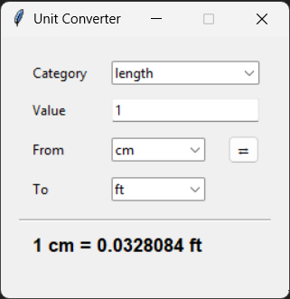

# Unit Converter

The Unit Converter program focuses on converting units to a desired unit. For example, converting feet to centimeters. It converts imperial and metric units based on what the user inputs. The main program is GUI-based, and you can switch units and convert as many as you want. The interface of the program enhances the user experience by its simplicity and reusability. Instead of calculating the units manually, the program handles conversion through its code.

## Installation

To install the unit converter, you must meet the requirements below to run the program:

Python 3.10 or newer, Git (optional), and any modern operating system.

**First, install the program by cloning the repository in Git.**

`git clone https://github.com/fritxfloriann/unit_converter.py`

You can also download the project as a ZIP file and extract it to your preferred folder.

**Second, open the unit converter folder.**

`cd unit converter`

**Third, install the dependencies and wrappers for `unit_converter.py`.

The following files are required to be downloaded for the unit converter program to work:

`cli.py`

`converter.py`

`unit_converter.py`

**Fourth, execute the program.**

Enter the command:

`python unit_converter.py`

It should launch the program. You will be greeted with the UI. Once installation is done, you can start using the program right away.

## Instructions

To use the unit converter program, you can start simple by converting your height from centimeters to feet. After that, you can progress to converting other units like distance, height, and width of an object. The program responds with a conversion rate that should be accurate. Those are just a few examples of how you can use the program. Here are step-by-step instructions on how to convert your input to a result.

**Select a conversion category**

Choose the measurement unit of what you want to convert *(e.g., centimeters, feet, meters, kilometers, liters, etc.)*. Once you are done choosing your measurement unit, you can start by entering numerical values.

**Enter a numerical input**

When prompted, enter the desired number of the unit you want to convert to. This will automatically convert the unit upon entering. For example, entering the number 163 CM to FT will result in 5'3 ft. This is an example. The results depend on what numerical value and conversion unit you input. Remember, the program automatically converts the inputs you entered. You must double-check what you entered before converting.

**Resetting**

You can always reset the program to convert a new number by removing the number values in the textbox or exiting the program. This will wipe the inputs you entered. After that, you can start your new conversion.

## Features

The unit converter has several features baked into its own program. Each of these features improves user experience, provides more operations, improves capability, and delivers quality performance.

*This section refers to the `unit_converter.py` program*

### Unit Conversion and Measurement Units

This program offers a couple of units for the user to convert to. There is a category of conversion units that you can pick from. This includes:

- *Length*

- *Mass*

- *Volume*

- *Temperature*

Each conversion unit has its own measurement unit. Here are some of the measurement units you can find in the category:

- *Centimeter* — **Length**

- *Inch* — **Length**

- *Kilogram* — **Mass**

- *Milligram* — **Mass**

- *Liter* — **Volume**

- *Tablespoon* — **Volume**

- *Celsius* — **Temperature**

- *Fahrenheit* — **Temperature**

*More can be found in the program*

The user can pick between the categories and the measurement units to convert their numerical value. By putting their number in the text box and picking the correct conversion unit and measurement unit, they will get an accurate result of the converted value. The UI is designed to be simple and easy to use. Converting from imperial units to metric units is easy in `unit_converter.py`.

There is also a button available in the program where you can swap the conversion of From and To. For example, if you want to swap between converting from mL to L, you can click the swap button on the right to swap to the L-to-mL conversion. This makes swapping measurement units simpler.

### User Input

The program is mainly navigated using your cursor. Drop-down menus and selections are embedded into the interface, while the results are at the bottom of the interface. The program utilizes text boxes and drop-down menus for users to make their selections. The options they input will be used to convert their numerical inputs into a result.

*By clicking on the categories of the conversion units listed, you pick between imperial and metric units to convert.*

As simple as how simple mouse navigation is, keyboard input will be implemented in the future to make converting much more faster by letting the users type on their keyboard to choose instead of navigating and clicking on boxes. You can still use mouse navigation, as keyboard input is implemented alongside mouse input to support two inputs at once.

### Error Handling

The unit converter program also has error handling, built for invalid inputs for the numeric value, crashes, and user errors. Error handling in the unit converter program is designed to prevent the user from inputting invalid data or inputs to the program that could cause it to crash. Error handling is present when the user inputs an invalid numerical value.

For example, entering letters or symbols in the numeric value text box can cause error handling to activate. By inputting invalid inputs like letters and symbols, the program will display an error, prompting the user to enter a valid number. You can resolve this error by deleting the input in the Value text box.

### GUI Interface

The unit converter program has a simple and minimalistic interface that only focuses on conversion. It also features a swap button and a light gray color scheme. The interface is basic, but future updates will improve it through gradual implementations. The GUI upgrade from the original program to the modern program is impactful, as a GUI-based program is more interactive and readable than a terminal-based program.

  The GUI interface for the unit converter looks like this:

  

 unit_converter.py 

  The GUI interface is subject to change over time.

## Legacy Files

As main programs change, depending on the new version, they may move to the legacy folders. Legacy folders are implemented to preserve files, help with organization, save space, and improve structure. Depending on the changes, the file moves to the folder, reserving space for new code and files to be stored.

For example:

A terminal-based program transitions to a GUI interface

A program gets discontinued

The program gets replaced with a new implementation

These changes move the old program to the legacy folder, which preserves the last major version of that file in the folder. It also helps with organization, saves space, and improves code quality. This is done to make folders look professional and organized. Remember, some files are subject to maintenance, modification, or changes, but it depends on the file itself whether it needs them. (e.g., vulnerabilities, errors, etc.)

*Subject to copyright*
